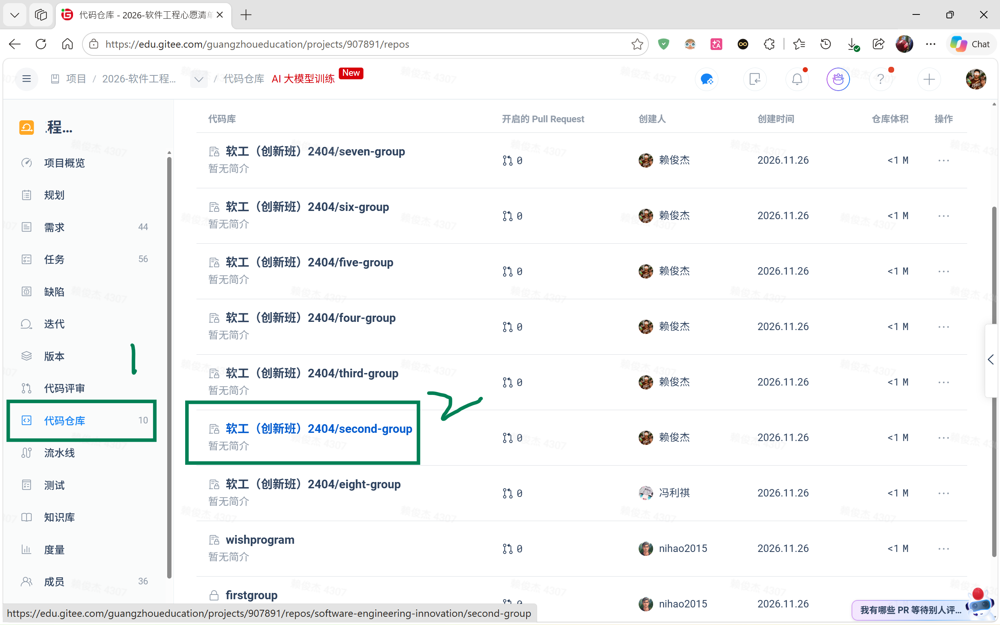
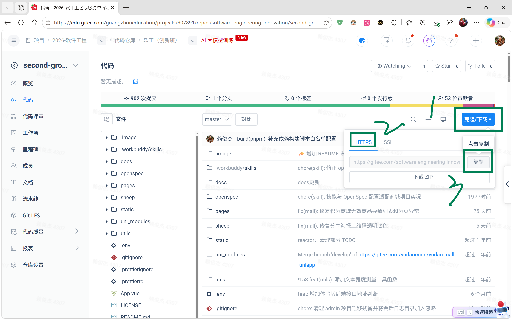
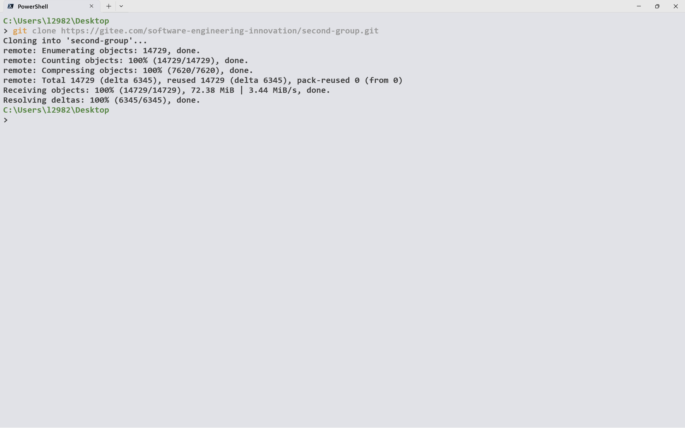
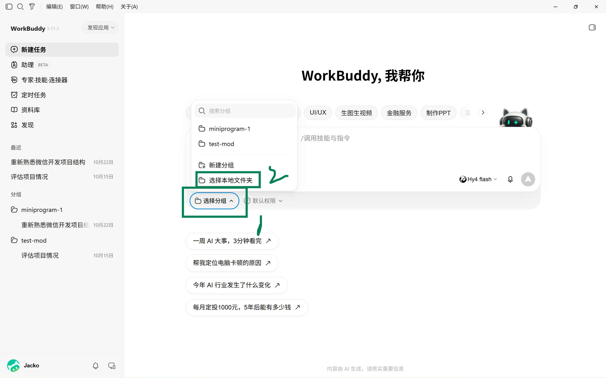
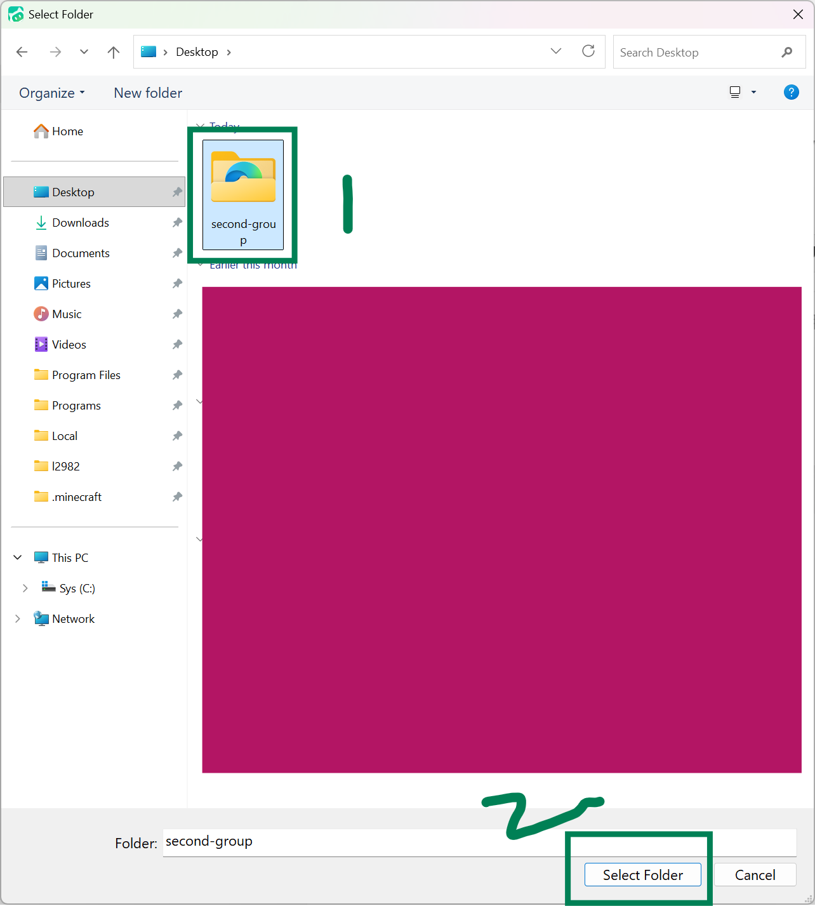
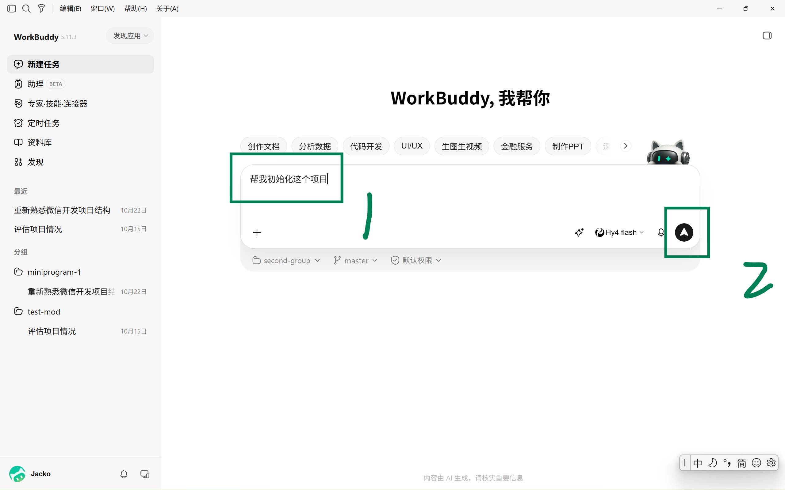
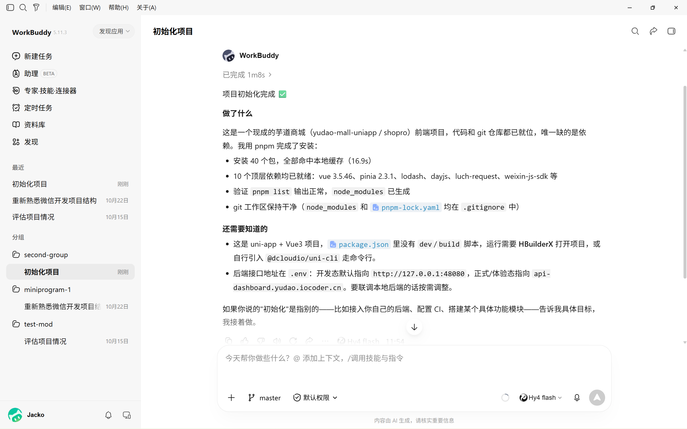
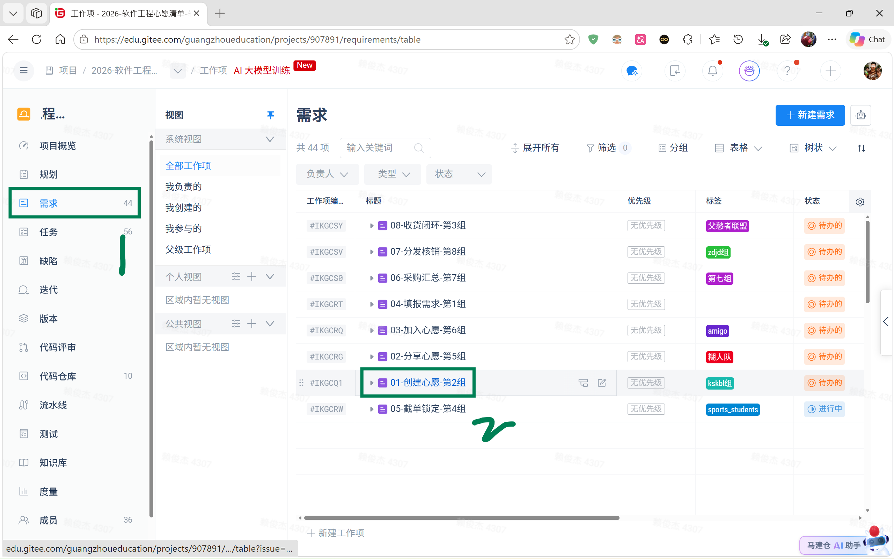
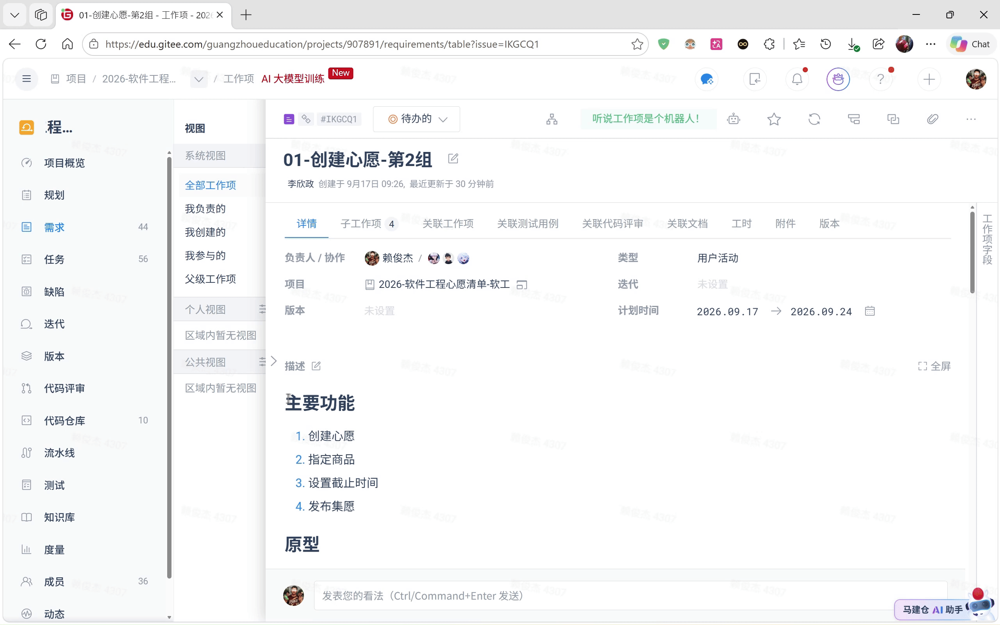
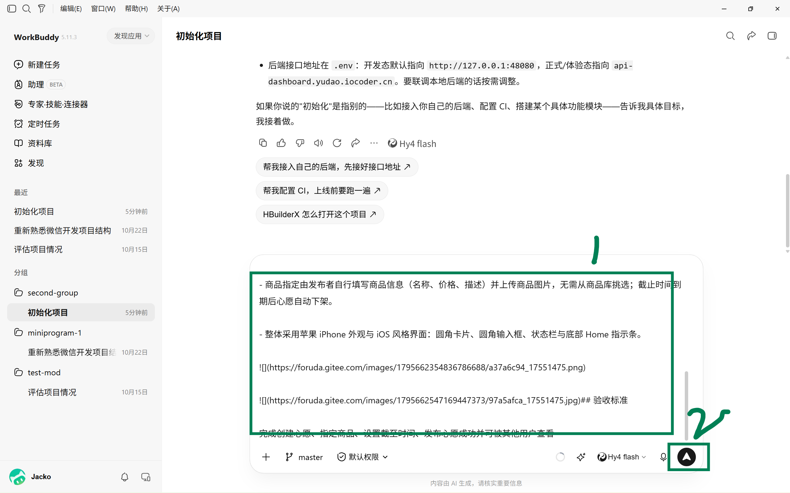

# 用 Gitee 和 WrokBuddy 来开发

## 拉取代码仓库到本地
### 复制你组代码仓库的链接

:::warning ⚠️注意
`步骤 2`: 请选择**你组**的代码仓库
:::

### 在命令行拉取你组的代码仓库
```sh
git clone <你组的链接>
```


## 让 WorkBuddy 帮你初始化项目
### 在 WorkBuddy 中打开代码仓库


:::warning ⚠️注意
`步骤 1`: 请选择你**实际拉取**下来的文件夹
:::
### 初始化项目
向 WrokBuddy 输入
```txt
帮我初始化这个项目
```


:::tip
如果 Workbuddy 有提示要授权做些什么就一路授权
:::
## 让 WorkBuddy 帮你完成需求
### 复制你组的需求

:::warning ⚠️注意
`步骤 2`: 请选择**你组**的需求
:::

### 粘贴给 WorkBuddy 并让它开始为你工作

